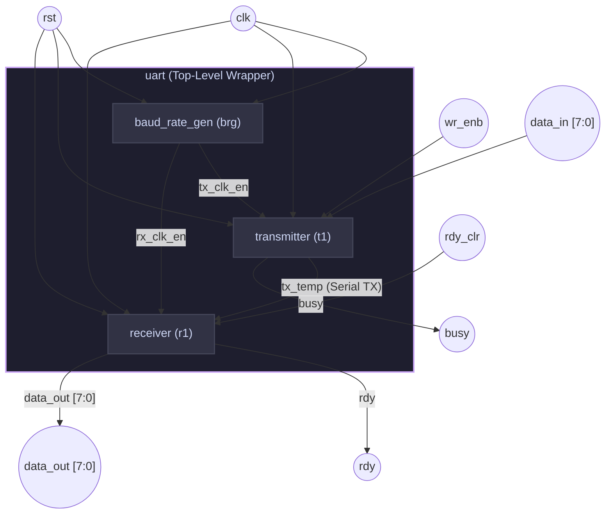
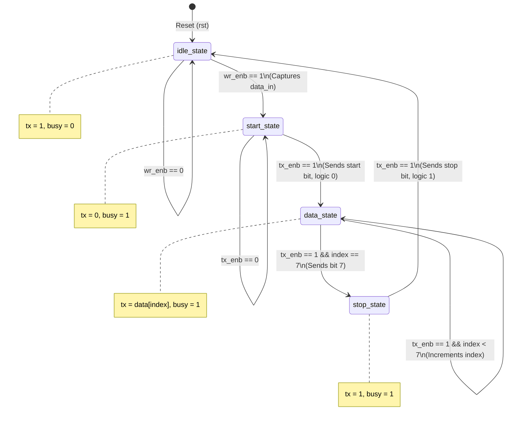
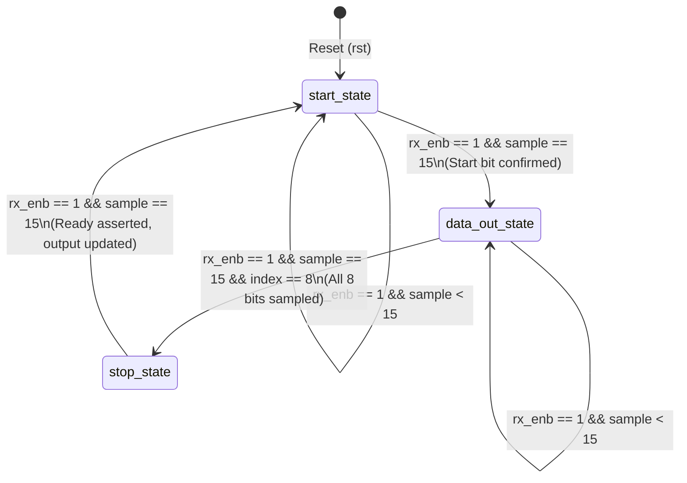

# Loopback UART Transceiver with Baud Rate Generator

This directory contains a complete, self-contained **UART (Universal Asynchronous Receiver-Transmitter) Transceiver** module written in Verilog. Designed for loopback communication, it includes a baud rate generator, a transmitter with a status flag, and a receiver utilizing $16\times$ oversampling for noise filtering and robust data extraction.

---

## 🏗️ System Architecture

The top-level `uart` module wires the transmitter's serial output (`tx`) directly to the receiver's serial input (`rx`) using an internal signal (`tx_temp`). This loopback architecture is ideal for self-testing, system verification, and local diagnostic logic.

---

## 🔌 Port Definitions & Interface

### Top-Level Module (`uart`)

| Port Name  | Direction | Bit-Width | Description                                                        |
| ---------- | --------- | --------- | ------------------------------------------------------------------ |
| `clk`      | Input     | `1`       | System Clock (Default: 50 MHz).                                    |
| `rst`      | Input     | `1`       | Asynchronous Active-High Reset.                                    |
| `wr_enb`   | Input     | `1`       | Write Enable; pulse high to load `data_in` and begin transmission. |
| `rdy_clr`  | Input     | `1`       | Ready Clear; pulse high to clear the receiver's `rdy` status flag. |
| `data_in`  | Input     | `8`       | Parallel data byte to transmit.                                    |
| `busy`     | Output    | `1`       | Active-high status flag indicating transmitter is active.          |
| `rdy`      | Output    | `1`       | Active-high status flag indicating a new byte has been received.   |
| `data_out` | Output    | `8`       | Parallel data byte received.                                       |

---

## ⚙️ Sub-Module Specifications

### 1. Baud Rate Generator (`baud_rate_gen`)

Divides the master `clk` input down to appropriate baud ticks. For a system clock of **50 MHz** and a target speed of **9600 Baud**:
- **TX Baud Tick (`tx_enb`)**: Generates an enable pulse every **5208** clock cycles.
  $$\text{TX Ticks} = \frac{50,000,000 \text{ Hz}}{9600 \text{ Baud}} \approx 5208 \text{ cycles}$$
- **RX Baud Tick (`rx_enb`)**: Generates an oversampling tick at $16\times$ the baud rate (every **325** clock cycles) to facilitate start-bit detection and midpoint data sampling.
  $$\text{RX Ticks} = \frac{50,000,000 \text{ Hz}}{9600 \text{ Baud} \times 16} \approx 325 \text{ cycles}$$

---

### 2. Transmitter (`transmitter`)

Performs parallel-to-serial conversion using a 4-state Finite State Machine (FSM):

- **States**:
  - `idle_state` (`2'b00`): Drives `tx` high (`1'b1`). Transitions to `start_state` when `wr_enb` is asserted, capturing the input byte into a holding register.
  - `start_state` (`2'b01`): Drives the serial line low (`1'b0`) to signal the start bit upon the next `tx_enb` tick.
  - `data_state` (`2'b10`): Shifts out 8 data bits sequentially (LSB first) driven by `tx_enb` ticks.
  - `stop_state` (`2'b11`): Drives `tx` high (`1'b1`) to signal the stop bit.
- **Status Flag**: `busy` is asserted throughout the entire process (`state != idle_state`).

---

### 3. Receiver (`receiver`)

Extracts incoming data from the serial line using $16\times$ oversampling to locate the center of each bit period, avoiding noise and clock skew.

- **FSM Operation & Oversampling Ticks**:
  - **Start Bit Verification**: In `start_state` (`2'b00`), the receiver waits for `rx` to drop to `1'b0`. If `rx` remains low, the `sample` counter increments on every `rx_enb` pulse. If it reaches `15` (equivalent to a full bit duration), the receiver confirms a valid start bit and transitions to `data_out_state`. A glitch/noise that returns `rx` to `1'b1` resets the `sample` counter.
  - **Mid-Bit Sampling**: In `data_out_state` (`2'b01`), the receiver counts 16 `rx_enb` pulses per bit. When `sample` reaches `8` (exactly the middle of the bit period), the state of `rx` is latched into `temp_register[index]`. When all 8 bits are read, it transitions to `stop_state`.
  - **Ready & Output**: In `stop_state` (`2'b10`), the receiver waits 16 oversampling ticks for the stop bit. Once verified, the received byte is loaded into `data_out` and the `rdy` output goes high.